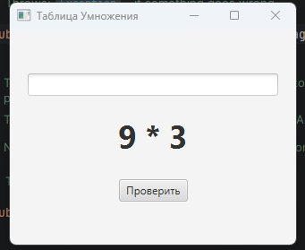
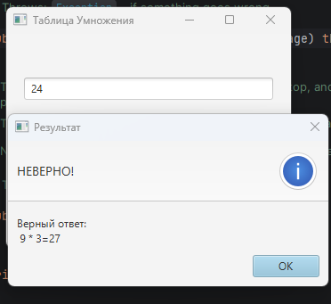
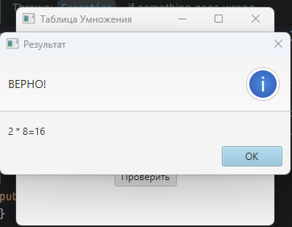
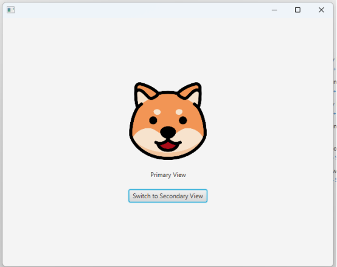
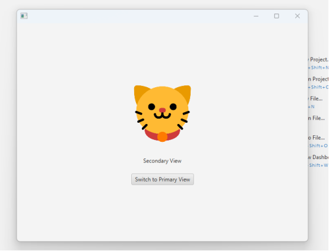
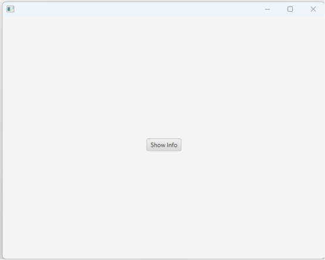
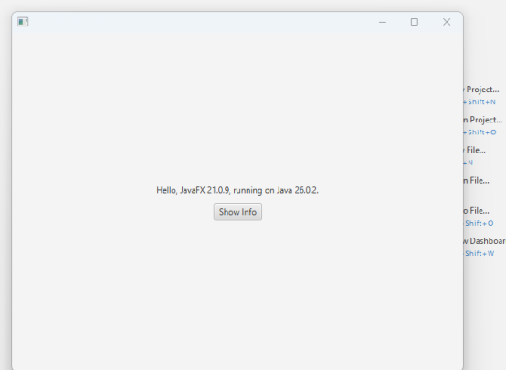

ИНСТРУКЦИЯ ПО ПРАКТИЧЕСКОМУ ЗАДАНИЮ
ОСНОВНОЕ ЗАДАНИЕ
Автор решения ________________________________

В рамках основного задания разработаны три оконных приложения на JavaFX, демонстрирующие разные способы создания графического интерфейса и работу в разных средах разработки. Тема лабораторной работы — создание оконного приложения Java различными способами. Цель — научиться собирать GUI-приложения в IntelliJ IDEA и Apache NetBeans как с визуальным редактором (FXML / Scene Builder), так и вручную, исключительно кодом. Все проекты собраны на Maven: зависимости JavaFX подключаются через архетипы и pom.xml, отдельная ручная установка JavaFX не требуется. Код выполняется на JVM, поэтому интерфейс остаётся кроссплатформенным при наличии подходящей версии JDK.

Первое приложение — MultiplicationTable1 — создано в IntelliJ IDEA Community Edition как Maven-проект JavaFX. Интерфейс описан в файле hello-view.fxml и собран визуально в Scene Builder: контейнер VBox с выравниванием по центру, поле ввода TextField, метка Label со шрифтом System Bold 36 px и кнопка «Проверить». Разметка связана с контроллером HelloController через fx:controller и идентификаторы fx:id. Логика вынесена в контроллер: при инициализации (интерфейс Initializable, метод initialize) генерируется пример на умножение, фокус ставится в поле ввода. Генератор multiplicationGenerator выбирает случайные множители от 2 до 9, сохраняет произведение в поле result и выводит строку вида «a * b». По нажатию кнопки (onAction="#onHelloButtonClick") ответ читается из TextField, преобразуется методом Integer.parseInt внутри блока try-catch: при вводе не числа показывается диалог Alert с текстом «Введите число!» и фокус возвращается в поле. При верном ответе выводится сообщение «ВЕРНО!», при неверном — правильное произведение. После закрытия диалога формируется новый пример, поле очищается. Заголовок окна задаётся в HelloApplication: stage.setTitle("Таблица Умножения"); сцена загружается через FXMLLoader, окно отображается методом stage.show(). Для запуска в модульной среде добавлен класс Launcher.

Рисунок 1. Главное окно приложения «Таблица Умножения»: поле ввода ответа, сгенерированный пример и кнопка «Проверить».

Рисунок 2. Диалог при неверном ответе: пользователь ввёл 24, верный результат примера 9 × 3 равен 27.

Рисунок 3. Диалог при верном ответе: сообщение «ВЕРНО!» и проверка примера 2 × 8 = 16.

Второе приложение — DogAndCat — создано в Apache NetBeans как Maven-проект JavaFX с разметкой FXML. Встроенного визуального редактора в NetBeans нет, поэтому макеты primary.fxml и secondary.fxml редактировались во внешнем Gluon Scene Builder. Интерфейс двухстраничный: на каждой странице в контейнер VBox добавлен ImageView с изображением (собака / кот, файлы в каталоге images рядом с FXML), метка и кнопка переключения вида. Изображения подключаются через Image url="@images/...". Логика навигации оставлена в контроллерах: PrimaryController методом switchToSecondary вызывает App.setRoot("secondary"), SecondaryController возвращает на primary. Класс App хранит общую Scene, загружает FXML через FXMLLoader и показывает окно размером 640×480. В результате кнопки переключают корневой узел сцены без создания нового окна.

Рисунок 4. Первая страница приложения DogAndCat (Primary View): изображение собаки и кнопка перехода на вторую страницу.

Рисунок 5. Вторая страница приложения DogAndCat (Secondary View): изображение кота и кнопка возврата на первую страницу.

Третье приложение — mavenproject1 — выполнено в NetBeans как простой Maven-проект JavaFX без FXML. Интерфейс строится программно в методе start класса App: создаются пустая Label и кнопка «Show Info», обработчик setOnAction по нажатию записывает в метку версии Java и JavaFX, полученные из класса SystemInfo (системные свойства java.version и javafx.version). Компоненты упакованы в VBox с выравниванием Pos.CENTER, контейнер помещён в StackPane, сцена имеет размер 640×480 и отображается через stage.show(). Импортируются пакеты javafx.application, javafx.scene.control, javafx.scene.layout, javafx.event и javafx.geometry. Такой подход показывает отличие ручного конструирования GUI от визуального дизайнера: расположение, обработчики и внешний вид задаются только кодом, без Scene Builder и FXML.

Рисунок 6. Приложение без FXML сразу после запуска: метка пустая, отображается только кнопка «Show Info».

Рисунок 7. То же приложение после нажатия «Show Info»: в метке выведены версии JavaFX 21.0.9 и Java 26.0.2.

Во всех трёх проектах используется модель обработки событий JavaFX: действие пользователя порождает событие (ActionEvent), которое передаётся слушателю (лямбда setOnAction или метод, указанный в onAction FXML). Компоненты (Button, Label, TextField, ImageView) размещаются в контейнерах (VBox, StackPane). Корректное отображение окна обеспечивается методами setScene и show; закрытие стандартное для JavaFX Stage. Обработка ошибок реализована в генераторе таблицы умножения через перехват NumberFormatException и информационные диалоги Alert. Сборка и запуск выполняются средствами IDE и плагина javafx-maven-plugin (mvn javafx:run / зелёная кнопка запуска). Таким образом, лабораторная работа покрывает создание оконного приложения визуальным конструктором в IntelliJ IDEA, внешним Scene Builder в NetBeans и полностью программным способом без FXML.
